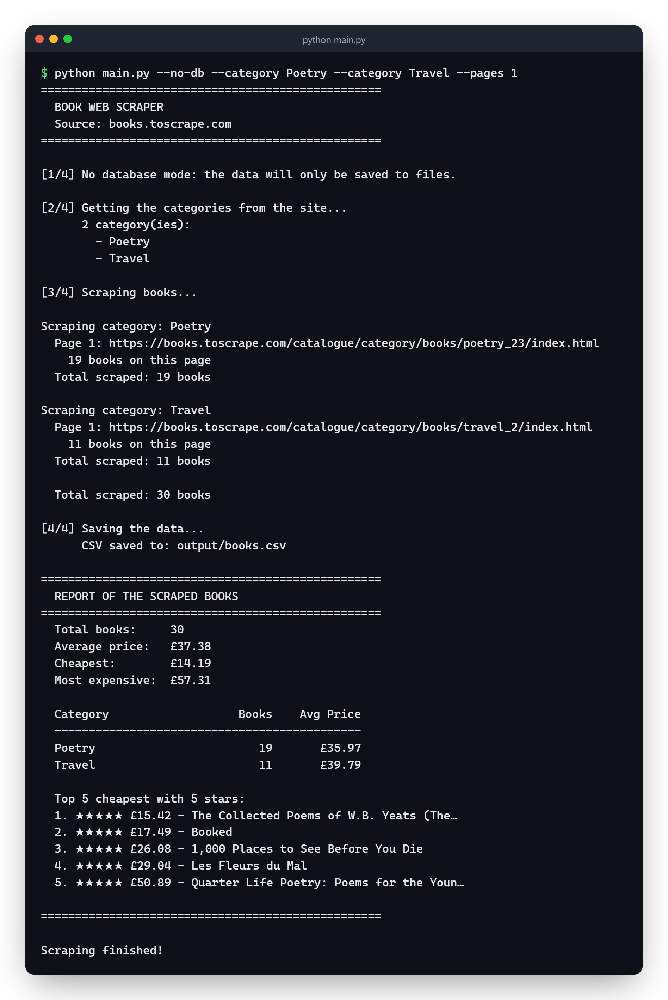
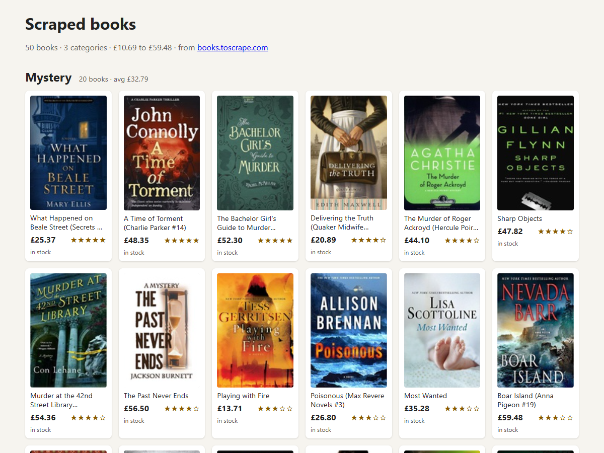

# Book Web Scraper


A Python scraper that collects books from [books.toscrape.com](https://books.toscrape.com), a site made exactly for practicing scraping. It grabs the title, price, rating, availability, category and cover, saves the data and shows a summary at the end.

I used requests and BeautifulSoup. The data can go to PostgreSQL or just to a CSV/JSON file.

## Running

```bash
python -m venv .venv
.venv\Scripts\activate        # on Linux/Mac: source .venv/bin/activate
pip install -r requirements.txt
```

Without a database, saving to CSV:

```bash
python main.py --no-db
```

With PostgreSQL:

```bash
psql -U postgres -c "CREATE DATABASE scraper_db;"
cp .env.example .env    # put your Postgres password in it
python main.py
```

Some options:

```bash
python main.py --no-db --categories 2 --pages 1
python main.py --no-db --category Poetry --category Travel
python main.py --no-db --json output/books.json
python main.py --no-db --html output/gallery.html
```

`--category` uses the name shown in the site's menu (case doesn't matter) and can be repeated. Without it, the scraper takes the first categories in the menu.

The CSV is saved with a BOM, so you can open it straight in Excel without the £ turning into a weird character.

By default it waits 0.8s between pages so it doesn't overload the site (you can change it with `--delay`). If a request fails, it retries a few times before giving up.

## Sample output

Running `python main.py --no-db --category Poetry --category Travel --pages 1`:



## HTML gallery

`--html` saves a single page with every book as a card: cover, price, stars and whether it's in stock, grouped by category with the best rated first. The covers are linked from the site instead of downloaded, so the file stays small (but needs internet to show them). It also follows the system's dark mode.



## Tests

```bash
python -m unittest discover -s tests
```

The tests use HTML written inside the test itself, so they don't hit the internet.

## Files

```
main.py             main flow and command line options
src/scraper.py      requests and HTML parsing
src/database.py     the PostgreSQL part
src/export.py       CSV, JSON, the HTML gallery and the summary
```

If you want to use the idea on another site, take a look at its `robots.txt` and terms of use first.
